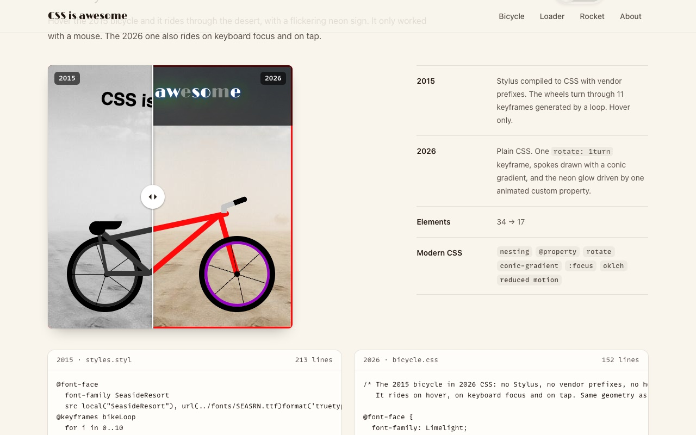
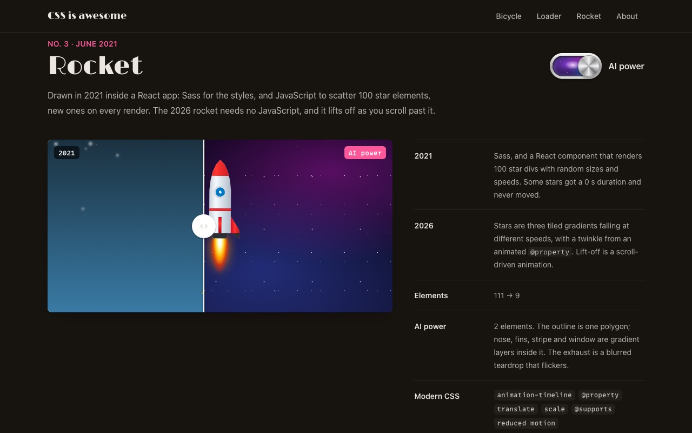
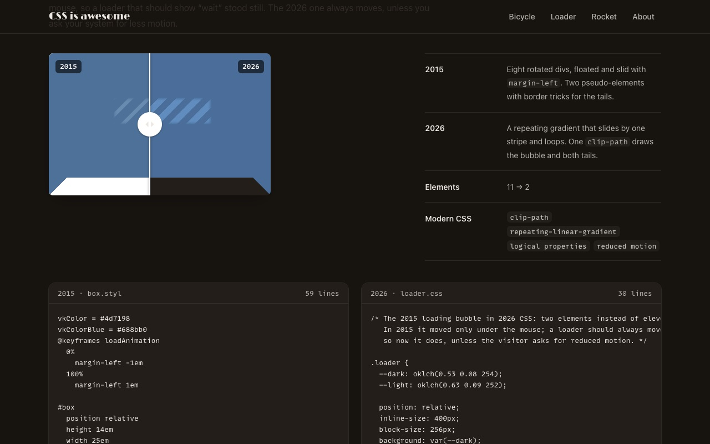

<div align="center">

# CSS is awesome

**Three drawings made only of HTML and CSS**: a bicycle and a loader from 2015, a rocket from 2021, redrawn in 2026 by hand and with Claude Code.<br>
Drag the divider over a drawing to compare the versions, flip the AI power switch, and read both stylesheets underneath.

### [▶ See it at css.avolkov.dev](https://css.avolkov.dev)

Best in Safari 26 or newer: the rocket lifts off with a scroll-driven animation.

<!-- Happy-path video: drag /private/tmp/claude-501/-Users-alex-Downloads-github/eba4b07d-fb10-47d6-8ce4-42740ad111e8/scratchpad/media/css3IsAwesome/happy-path.mp4 onto this line in the GitHub editor -->

  

</div>

## The drawings

Each drawing has three versions on the page: the original, my 2026 redraw with the same shapes, and the version I made with Claude Code, as good as we could get it in as little CSS as possible.

| Drawing | Original | 2026, by hand | 2026, with Claude Code |
|---|---|---|---|
| Bicycle (2015) | Stylus, 34 elements, 11 generated keyframes, rides on hover only | 17 elements: `rotate: 1turn`, gradient spokes, an animated `@property` for the neon; rides on hover, focus and tap | 2 elements, 73 lines: a road bike at sunset; the frame, saddle and bars are one `clip-path` polygon |
| Loader (2015) | 11 floated divs that move only under the mouse | 2 elements: one sliding repeating gradient, one `clip-path` for the bubble | 1 element, 44 lines: real "Loading…" text, stripes and a shine in one loop |
| Rocket (2021) | Sass in a React app that renders 100 random star divs | 9 elements: gradient stars, scroll-driven lift-off | 2 elements, 74 lines: a polygon outline with nose, fins and window as gradient layers, a flickering exhaust, a planet |

There is no automated judge for a drawing; your eyes are the judge. The numbers are measured, not typed: the page fetches each stylesheet and counts its lines (without comments and blank lines) when it loads. Every version respects `prefers-reduced-motion`.

The repo is the story: it started in March 2015, the React app from 2021 is kept at the tag [`legacy-2021`](https://github.com/slimcandy/css3IsAwesome/tree/legacy-2021), and `site/2015/` and `site/2021/` are the original files, shown in frames as they were, minus the music and a font I can't share.

## Run it locally

Needs Node 24 or newer.

```sh
git clone --depth 1 https://github.com/slimcandy/css3IsAwesome.git
cd css3IsAwesome
npm install
npm run build    # the page shell, site/style.css
npx serve site   # http://localhost:3000/
```

`npm run dev` rebuilds the page styles on change. `npm run card` remakes the link-preview card and the home-screen icon from the page (once: `npx playwright-core install chromium`). The drawings themselves (`site/2026/`, `site/ai/`) are plain CSS files with no build step.

## Credits

© 2015–2026 Aleksei Volkov. Titles use [Limelight](https://fonts.google.com/specimen/Limelight) by Sorkin Type (SIL Open Font License); code uses MonoLisa, which is licensed and fetched at build time, never committed.
